# AI News Aggregator

A personal daily news digest, curated by AI and delivered to your inbox at **9 AM Eastern** — fully automated and **100% free to run**.

Every morning a scheduled job collects the last 24 hours of news from trusted outlets and AI sources, uses **Google Gemini** to sort, rank and summarize it against a personal interest profile, and emails a clean digest with four sections:

| Section | What's in it |
|---|---|
| **Tech** | AI, startups, big tech, major scandals in industry |
| **Business** | US and Indian stock markets, big tech companies, the economy |
| **Politics** | Indian national politics, US politics, world affairs |
| **Education & Visas** | F-1, OPT / STEM OPT, H-1B and visa-rule changes for international students in the US |

Each section has 5 stories (at least 2 about India in Tech, Business and Politics), one story per news event, each with a 2–3 sentence summary and a link to the original article.

---

## How it works

```mermaid
flowchart LR
    subgraph Sources
        RSS[RSS feeds<br/>NYT, Times Now, TOI,<br/>OpenAI, Anthropic, USCIS…]
        GN[Google News searches<br/>CNN, TOI, Times Now,<br/>F-1 / H-1B]
        API[APIs<br/>Guardian, YouTube Data API]
    end

    Sources --> Collect[1. Collect<br/>last 24h]
    Collect --> DB[(PostgreSQL<br/>Docker locally<br/>Neon in the cloud)]
    DB --> Enrich[2. Enrich<br/>transcripts / full text<br/>for AI sources]
    Enrich --> Filter[3. Filter<br/>junk, duplicates,<br/>Gemini section check]
    Filter --> Curate[4. Curate<br/>Gemini ranks events<br/>vs. your profile]
    Curate --> Summarize[5. Summarize<br/>Gemini summaries;<br/>watches chosen videos]
    Summarize --> Email[6. Email<br/>HTML digest via Gmail]
    Email --> Inbox((Your inbox))
```



**Scheduling:** a GitHub Actions workflow runs the pipeline every morning. GitHub's schedule is UTC-only, so it runs at three UTC times and the code decides: runs before 8 AM Eastern skip themselves, and runs after today's email already went out skip themselves — so the email lands around 9 AM in both summer and winter time, exactly once.

### Design choices

- **Rank first, summarize later.** Hundreds of headlines arrive daily; Gemini ranks each section's candidates in one call, and only the ~20 winners get summaries. A full run uses about 12 free Gemini requests.
- **One story per event.** Gemini groups stories by event (several outlets cover the same news) and the code double-checks, so one event never takes several slots.
- **Headlines only from news publishers.** We use the headline and description from their feeds and link to the original; full text is only fetched for AI sources (YouTube transcripts, Anthropic posts), respecting `robots.txt`.
- **Resilient to free-tier limits.** Request spacing, retries, a backup Gemini model with its own free quota, section labels cached in the database, and fallbacks so the email always goes out.
- **YouTube from the cloud.** YouTube blocks transcript downloads from cloud servers, so for chosen videos Gemini watches the video itself from its link (first 20 minutes, low resolution, max 2 per day).

---

## Tech stack (all free)

| Part | Tool |
|---|---|
| Language / packages | Python 3.12, [uv](https://docs.astral.sh/uv/) |
| Feeds & scraping | feedparser, requests, trafilatura, youtube-transcript-api |
| AI | Google Gemini (free tier) via `google-genai`, Pydantic structured output |
| Database | PostgreSQL 17 in Docker (local), [Neon](https://neon.tech) free tier (cloud), SQLAlchemy |
| Email | Gmail SMTP with an app password (Gmail API and Brevo also supported) |
| Scheduling | GitHub Actions |

---

## Project structure

```
├── main.py                       # entry point: full daily pipeline
├── sources.yaml                  # every news source (adding one = one entry)
├── .github/workflows/daily.yml   # the daily schedule
├── docker/docker-compose.yml     # local Postgres (port 5433)
├── scripts/
│   ├── check_gemini.py           # test your Gemini key
│   ├── gmail_authorize.py        # one-time sign-in for the Gmail API option
│   └── upload_secrets.ps1        # copy .env values to GitHub Secrets
└── app/
    ├── config.py                 # settings, sections, time zone, sources loader
    ├── runner.py                 # runs all scrapers (registry by source type)
    ├── daily_runner.py           # collect → enrich → digest → email → clean up
    ├── scrapers/                 # base, rss, google_news, guardian, youtube
    ├── database/                 # models, connection, repository, create_tables, check_connection
    ├── agent/                    # Gemini helper, section classifier, curator, digest, email intro
    ├── profiles/user_profile.py  # name, interests per section, stories per section
    └── services/                 # filter, enrich, build_digest, email template, sending
```

---

## Run it locally

**Requirements:** Python 3.12+, [uv](https://docs.astral.sh/uv/), Docker Desktop, Git.

```bash
# 1. install dependencies
uv sync

# 2. start the local database (Postgres on port 5433)
docker compose -f docker/docker-compose.yml up -d

# 3. create your settings file, then fill it in (see below)
cp .env.example .env

# 4. check your Gemini key
uv run python scripts/check_gemini.py

# 5. build today's digest without sending → data/digest_preview.html
uv run main.py --no-send

# 6. full run: collect, rank, summarize and email
uv run main.py
```

Useful single steps:

| Command | What it does |
|---|---|
| `uv run python -m app.runner --dry-run` | Print the last 24h of headlines per section, without saving |
| `uv run python -m app.services.filter` | Show what the filter keeps, before and after |
| `uv run python -m app.services.build_digest` | Rank and summarize, print the digest |
| `uv run python -m app.services.process_email --preview` | Write the email preview without sending |
| `uv run python -m app.database.check_connection --production` | Check the Neon connection |

### Settings (`.env`)

Copy `.env.example` to `.env` — never commit `.env`.

| Setting | What it is |
|---|---|
| `GEMINI_API_KEY` | Free key from [Google AI Studio](https://aistudio.google.com/apikey) |
| `GEMINI_MODEL`, `GEMINI_FALLBACK_MODEL` | Main and backup models (defaults: `gemini-2.5-flash`, `gemini-3.5-flash-lite`) |
| `YOUTUBE_API_KEY` | Free YouTube Data API v3 key (Google Cloud Console) |
| `GUARDIAN_API_KEY` | Optional, free from the [Guardian Open Platform](https://open-platform.theguardian.com/access/) |
| `MY_EMAIL` | The address that receives the digest |
| `EMAIL_PROVIDER` | `gmail` (app password), `gmail_api` (OAuth) or `brevo` |
| `GMAIL_SENDER`, `GMAIL_APP_PASSWORD` | Sending Gmail account and its 16-letter app password (needs 2-Step Verification) |
| `TIMEZONE` | Your time zone for the digest date and 9 AM check (default `America/New_York`) |
| `ENVIRONMENT` | `local` (Docker) or `production` (Neon) |
| `DATABASE_URL` | Local Docker database |
| `PRODUCTION_DATABASE_URL` | Neon connection string (direct, not pooled) |

### Personalize it

- **Interests and story counts:** `app/profiles/user_profile.py`
- **Sources:** add or remove entries in `sources.yaml` (types: `rss`, `google_news`, `guardian`, `youtube`)
- **Email look:** `app/services/email_template.py`

---

## Deploy (free daily emails)

1. **Database:** create a free [Neon](https://neon.tech) project (region near GitHub's servers, e.g. AWS US East), copy the **direct** connection string into `.env` as `PRODUCTION_DATABASE_URL`, and create the tables:
   ```bash
   uv run python -m app.database.check_connection --production
   ```
2. **Secrets:** push the repo to GitHub, then copy your `.env` values into the repo's encrypted secrets (needs the GitHub CLI, `gh`):
   ```bash
   powershell -ExecutionPolicy Bypass -File scripts/upload_secrets.ps1
   ```
3. **Run:** the workflow in `.github/workflows/daily.yml` then runs every morning. To run it now: GitHub → **Actions** → **Daily news digest** → **Run workflow**.

Old articles (over 30 days, `RETENTION_DAYS`) are deleted after each run so the free database never fills up.

---

## Costs

Everything runs on free tiers: Gemini free tier (about 12 requests per day; the main model allows 20/day), YouTube Data API (about 4 of 10,000 daily units), Neon free plan, GitHub Actions (about 5 minutes per day), and Gmail. No credit card is required anywhere.
